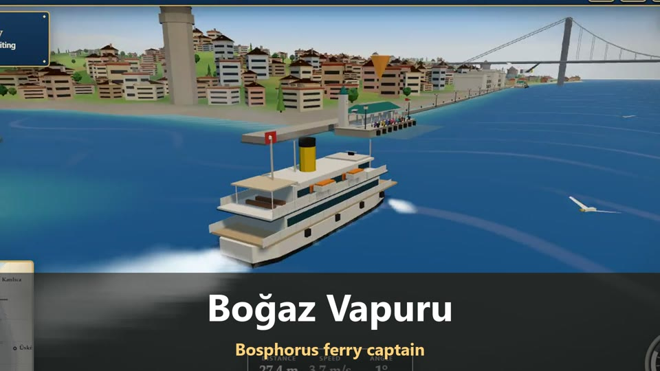
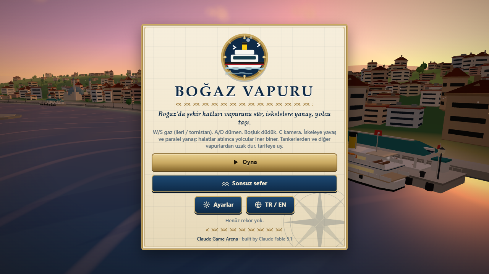
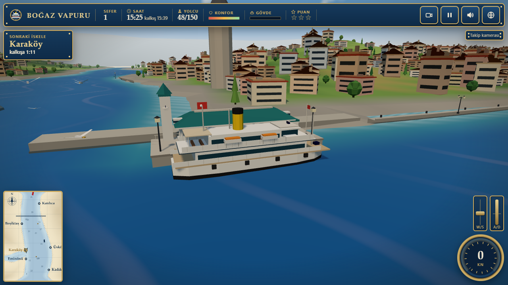
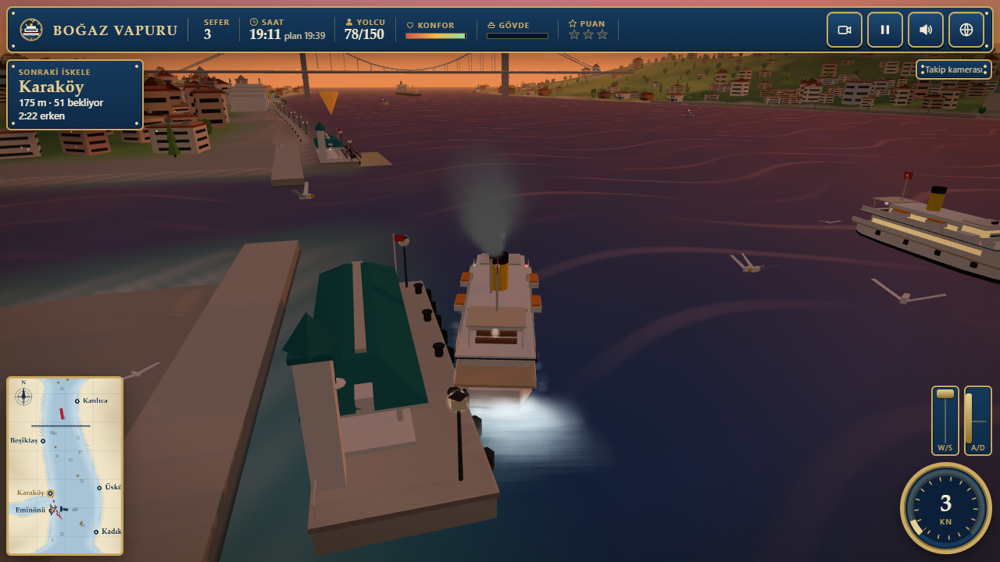
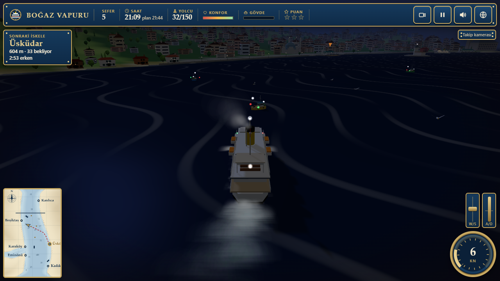
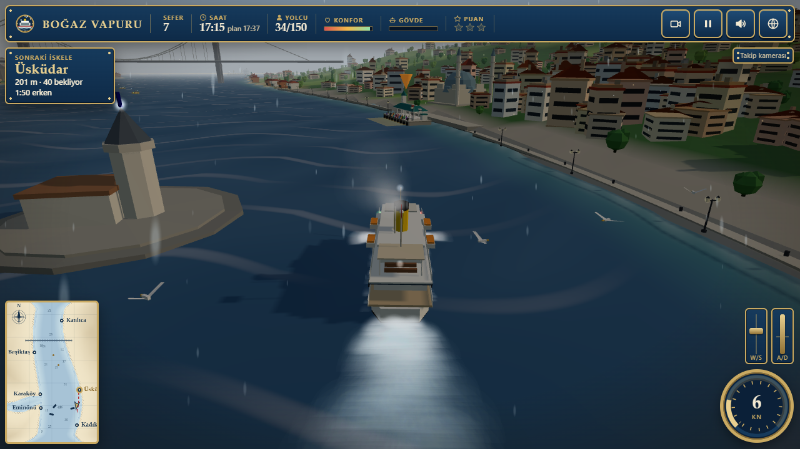
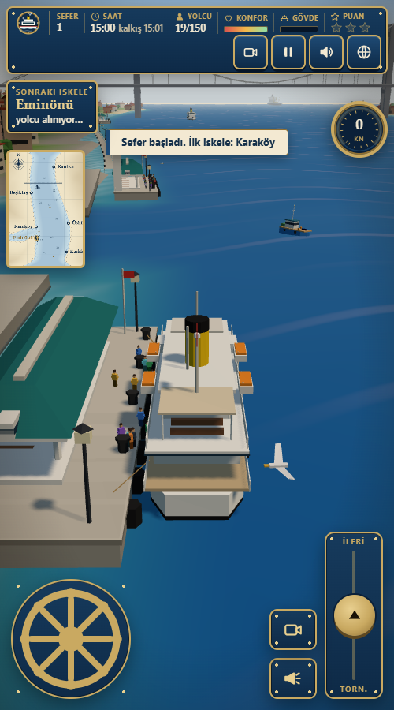
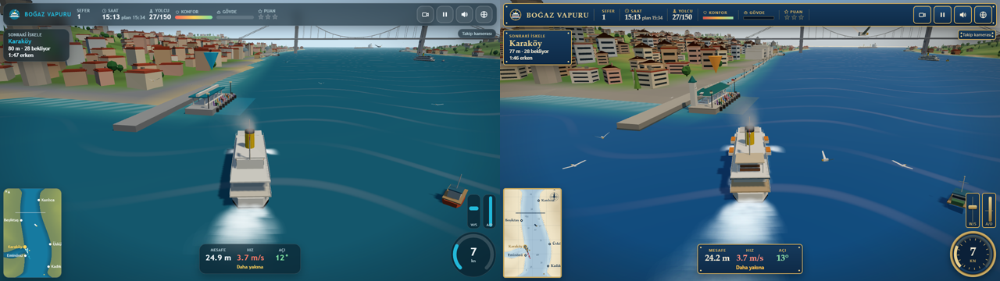

<p align="center">
  <a href="https://furkiozknn.github.io/bogaz-vapuru/">
    
  </a>
</p>

<p align="center">
  <a href="https://furkiozknn.github.io/bogaz-vapuru/"></a>
</p>

<p align="center">
  
  
  <a href="LICENSE"></a>
  
</p>

<!-- portals:start -->
<p align="center">
  Also on: <a href="https://furkiozknn.itch.io/bogaz-vapuru"><strong>itch.io</strong></a> &middot; <a href="https://playgama.ai/play/rrqp5tfena6yda"><strong>Playgama</strong></a>
</p>
<!-- portals:end -->

<p align="center">
  <strong>A 3D ferry-captain game on a low-poly Bosphorus: take the white city ferry with the yellow funnel between six piers, keep the timetable, come alongside gently and carry as many passengers as you can.</strong>
</p>

<!-- gameplay gif -->

## Features

- **Six piers across the strait:** Moor at Eminönü, Karaköy, Üsküdar, Beşiktaş, Kadıköy and Kanlıca on tight scheduled departure times where arriving more than 15 s late costs points and passengers give up after 40 s.
- **Precision maritime docking:** Slide alongside the berth under 1 m/s, parallel within 20 degrees and close for 0.5 s to secure the ropes; hard bumps over 0.7 m/s damage the hull, while 100% hull damage cancels the shift.
- **Dynamic Bosphorus campaign:** Master 8 varied shifts—including fog, night, current 1.0, a thunderous storm, and a convoy of 5 tankers—plus an endless mode with procedural route generation.
- **Three-star scoring & passenger comfort:** Earn up to 3 stars per shift (1 at 40%, 2 at 65%, 3 at 85% of target) balancing delivered passengers (&times;10), punctuality (up to 100 per stop), and passenger comfort (&times;3).
- **Ultra-lean procedural world:** A single `index.html` running Three.js r170 rendering 1100 buildings, 1500 trees, and dynamic water at 25–32 draw calls and 60 fps on Intel UHD 620, verified by an automated bot with 0 JS errors.

## How to play

> [!TIP]
> **Goal:** Sail each shift's route on time, dock cleanly at every pier and reach the shift target for 1 to 3 stars. No star means the shift must be repeated.

1. **Cast off on schedule:** Wait for passenger boarding to finish and departure time to arrive, then push the throttle lever forward (`W` or `Up`).
2. **Navigate the channel:** Steer with the wheel (`A` / `D`), compensate for the Marmara current and wind drift, and sound the horn (`Space`) to warn fishing boats and cross-traffic.
3. **Come alongside and dock:** Approach the teal berth box under 1 m/s, parallel within 20 degrees, and hold position for half a second until the ropes are thrown and the bell rings.

<details>
<summary><b>Rules and shift roster</b></summary>

- **Hard bumps** (over about 0.7 m/s into a pier, the shore or another boat) damage the hull and upset the passengers. At 100% hull damage the shift is cancelled. Collisions with tankers hurt a lot.
- **Punctuality:** Arriving more than 15 s late costs points, and after 40 s the waiting passengers start to give up. Arriving early means waiting at the pier until the scheduled departure.
- **Comfort** starts at 100% and drops with hard docking, collisions, hard rudder at speed, slamming the telegraph from ahead to astern, and speeding through a storm.
- **Score:** Passengers delivered &times; 10 + punctuality (up to 100 per stop) + comfort &times; 3 &minus; 5 per lost passenger. Stars: 1 at 40% of the shift target, 2 at 65%, 3 at 85%.
- **Navigation tip:** Aim a little up-current when approaching a berth. Tankers blow the horn and slow down a little when something is ahead, so stay out of their way.

| # | Shift | What is new |
|---|---|---|
| 1 | First crossing | Eminönü, Karaköy, Üsküdar: learn to dock |
| 2 | Beşiktaş line | Longer legs, more traffic |
| 3 | Evening run | Five piers while the sun sets, lights come on |
| 4 | Foggy morning | Fog run (Sis Seferi): blind radar, navigate by horn echoes and pier lanterns |
| 5 | Night shift | Night, pier lanterns and bridge lights |
| 6 | Strong current | Current 1.0: the ferry drifts mid-strait |
| 7 | Storm | Wind, waves, rain, thunder: slow down for comfort |
| 8 | Tanker convoy | A convoy of five tankers at dusk, heavy traffic |
| E | Endless | Random routes that get harder; ends on a failed shift |

</details>

### Fog run (Sis Seferi)

A foggy-day mode where you navigate by sound and light instead of the radar.

- **When:** campaign shift 4 and the fog days of endless mode (shifts with `fog >= 1` in the shift table) are always fog runs. For any other shift, turn on **Fog run** on the shift screen before you start. `?fog` forces it on every shift.
- **Fog:** visibility ends at about 150 m (three.js fog 8 to 190 m), so piers and other boats fade out.
- **Blind radar:** the minimap shows no route, no traffic and no pier labels. Only the marks left by your horn's echoes and by other boats' fog horns show up, for a few seconds.
- **Fog horn and echo (`Space` or the horn button):** each blast echoes back from every pier within 700 m (the three nearest answer, with a pier bell) and from the nearest shore on each side. Each echo comes back after the time sound needs to get there and back (2 × distance ÷ 343 m/s, so 100 m is about 0.6 s and 300 m about 1.75 s). In stereo it is panned towards its source. A sound front spreads out on the radar at the speed of sound.
- **Lights through the fog:** pier lanterns and the Maiden's Tower light are drawn without fog. The next pier burns amber and flashes every 2 s, and the tower flashes white every 3 s.
- **Fair traffic:** a boat within about 110 m, or one on a collision course within 30 s, sounds its fog horn from its own direction before contact. A tanker's horn is low, a ferry's is in the middle and a fishing boat's is high.
- **Bonus:** every docking in fog adds 50 to 100 points, depending on how slowly and how parallel you dock. It is listed as "Fog bonus" on the shift report.
- **`?auto`:** the bot steers by the game's internal state as before, and sounds the fog horn every 15 s.

### Controls

| Action | Mouse / touch | Keyboard |
|---|---|---|
| Throttle ahead / astern (sticky telegraph) | Right lever (up = ahead, down = astern) | `W` / `S` or `Up` / `Down` |
| Rudder (returns to midships) | Wheel on the left | `A` / `D` or `Left` / `Right` |
| Horn (fog horn with echoes on a fog run) | Horn button | `Space` |
| Camera (chase / bridge / top) | Camera button | `C` |
| Orbit the chase camera | Drag on the scene, wheel to zoom | Drag / scroll wheel |
| Pause | Pause button | `P` / `Esc` |
| Audio & settings | HUD buttons | `M` music, `X` effects, `L` language |
| Fullscreen | Settings button | `F` |

- **Touch:** Wheel on the left, throttle lever on the right, and dedicated HUD buttons for horn, camera, pause, and settings.
- **Persistence:** Settings are saved in `localStorage` under `arena.vapur.settings`; best stars and scores and the campaign you can continue under `arena.vapur.save`.
- **Language & performance:** Language follows the browser (Turkish or English); phones start automatically on the Low tier.

<details>
<summary><b>URL flags for testing</b></summary>

| Flag | Effect |
|---|---|
| `?auto` | A captain bot plays the campaign with the same controls and rules (fairway routing, slows for traffic, docks parallel) |
| `?debug` | FPS, draw calls, triangles, state, bot results and JS errors on screen; `window.vapurSim(seconds)` fast-forwards |
| `?sim=N` | Fast-forward N seconds of the first shift before the first frame (add `&auto` to let the bot sail) |
| `?low` | Shadows off, pixel ratio 1, half the particles |
| `?noassets` | Kept for the arena test suite: no asset files are fetched in any case (every sound is synthesised) |
| `?lang=en` / `?lang=tr` | Language |
| `?shift=N` | Start the campaign at shift N |
| `?mode=endless` | With `?auto` or `?sim`, start in endless mode |
| `?seed=N` | Gameplay random seed (default 11) |
| `?touch` | Force the touch controls |
| `?fog` | Every shift is a fog run (Sis Seferi) |
| `?cal` | With `?auto`: advance to the next shift whatever the result (used to calibrate the targets) |

`window.vapur` exposes the live state (`state`, `shift`, `time`, `score`, `target`, `aboard`, `delivered`, `hull`, `comfort`, `finishedShifts`, `errors`). Example: `index.html?auto&debug&sim=3000` plays most of the campaign in a few seconds without rendering.

</details>

## Screenshots

<table>
  <tr>
    <td width="33%"><br><sub>Title screen</sub></td>
    <td width="33%"><br><sub>Moored at Karaköy</sub></td>
    <td width="33%"><br><sub>Evening run at dusk</sub></td>
  </tr>
  <tr>
    <td><br><sub>Night, Maiden's Tower</sub></td>
    <td><br><sub>Storm at Üsküdar</sub></td>
    <td><br><sub>On a phone</sub></td>
  </tr>
</table>

## Redesign & Performance

**Art direction:** Stylized low-poly 3D with a cinematic golden-hour default. Palette: Bosphorus blue `#145DA0`, sunset `#F28C28` to `#7B2CBF`, the white ferry with its yellow-and-black funnel, pastel yalıs, bridge steel `#6B7280`; the UI is a maritime chart (navy instrument panels with brass edges, parchment chart cards, rope dividers).

**Visual updates (gameplay, physics, levels, scoring, saves, and the bot are untouched):**
- **Light and sky:** A three-stop sky with a sun glow and violet band at dusk, golden-hour grade when the sun is low, drifting cloud clusters, warmer fog; water has Bosphorus blue with grazing sky reflections, sun glitter path, and lace foam. The title scene is set at 18:30.
- **Shores:** Town houses with window bands and parapets or terracotta hip roofs; sea walls with bollards and ornate lamp posts; Dolmabahçe-like palace, Rumeli Hisarı-like fortress, and Haydarpaşa-like station join mosques and towers; distant hills; layered tree canopies and yalıs with shutters, boathouses, and chimneys.
- **Boats and piers:** The ferry has a red boot-top, teak deck, bridge wings, lifeboats on davits, aft awning with benches, fenders, name board, and flag emblem; tankers carry pipe runs, derrick cranes, and a lifeboat; fishing boats have nets, buoys, and mast lamps; piers have slate-green hipped halls, clock towers, ticket booths, benches, and flagpoles.
- **Motion:** Layered wake (stern churn, foam carpet, bow wave, spray at speed, foam collar) that dims at night; cinematic docking camera drifting over the water to frame the ferry against the pier with slow moored orbit; slightly wider field of view at speed.
- **UI:** Brass-edged navy HUD with serif numerals, brass-bezel log dial, nautical minimap with soundings and compass rose, parchment chart cards with rope dividers, compass-ring logo; adjusted phone portrait and landscape layouts (docking guide moves to top in landscape).
- **Cleanup:** Lookups for optional `assets/sfx/*.mp3` files removed (never shipped and produced 404s).

**Measured on an Intel UHD 620 (1280x720, High tier):**
- Draw calls: 21–28 &rarr; 25–32
- Geometry: ~224,000 &rarr; ~440,000 triangles
- Page rAF: 60 fps (vsync-capped) in title, docking, dusk, night, storm, and phone scenes
- Verification: `?auto` captain finishes the campaign with 3 stars on every shift, with and without `?noassets`, with 0 JS errors (retries on shifts 5 and 8 as before)



## Running locally

Serve the folder over HTTP (opening `index.html` directly also works in most browsers):

```bash
python -m http.server 8000
```

Then open <http://localhost:8000/>.

## Made with Claude Code

Built by **Claude Fable 5.1** with Claude Code from one prompt: [prompts/bogaz-vapuru.md](prompts/bogaz-vapuru.md). Redesigned by **Claude Fable 5.1** with Claude Code on the `redesign` branch.

<details>
<summary><b>Technical notes</b></summary>

- **Procedural generation:** The entire world is procedural with zero asset files shipped. The strait is a signed depth function from which shoreline, terrain, piers, fairway graph, and minimap are computed.
- **Instanced & merged geometry:** The city (~1100 buildings), yalı mansions, 1500 trees, people, and gulls are instanced; mosques, Galata and Maiden's towers, piers, and suspension bridge use merged flat-shaded geometry.
- **Water shader:** Patched MeshLambertMaterial with procedural sine waves and current streaks.
- **Web Audio API:** Engine rumble, two-tone horn, pier bell, gulls, sea, wind, rain, thunder, and calm saz-and-strings loop are synthesised in real time with Web Audio.
- **Autonomous bot:** The `?auto` captain routes through the fairway graph, compensates for current drift, slows for traffic, and executes parallel docking.

</details>

### Claude Game Arena

Boğaz Vapuru is part of the **Claude Game Arena** series, where each game is built by a Claude model from one prompt.

[Hisar](https://furkiozknn.github.io/kale-savunmasi/) · [Çay Ocağı](https://furkiozknn.github.io/cay-ocagi/) · [Çini Ustası](https://furkiozknn.github.io/cini-ustasi/) · [Martı](https://furkiozknn.github.io/marti/) · [Kervan](https://furkiozknn.github.io/kervan/) · [Dolmuş](https://furkiozknn.github.io/dolmus/) · [Peri Golf](https://furkiozknn.github.io/peri-golf/) · [Mehter](https://furkiozknn.github.io/mehter/) · [Simit Fırını](https://furkiozknn.github.io/simit-firini/) · [Karagöz](https://furkiozknn.github.io/karagoz/) · [Lale Bahçesi](https://furkiozknn.github.io/lale-bahcesi/)

**Round 5:** [Kapadokya Balonu](https://furkiozknn.github.io/kapadokya-balonu/) · [Ebru](https://furkiozknn.github.io/ebru/) · [Kırkpınar](https://furkiozknn.github.io/kirkpinar/) · [Çarşı Kaçışı](https://furkiozknn.github.io/carsi-kacisi/)

**Round 6:** [Topkapı Gecesi](https://furkiozknn.github.io/topkapi-gecesi/) · [Hamsi](https://furkiozknn.github.io/hamsi/) · [Pamukkale](https://furkiozknn.github.io/pamukkale/) · [Mimar Sinan](https://furkiozknn.github.io/mimar-sinan/)

## License

MIT, see [LICENSE](LICENSE).

Like the game? You can support new rounds on [Buy Me a Coffee](https://buymeacoffee.com/furkiozkann). The game stays free.
