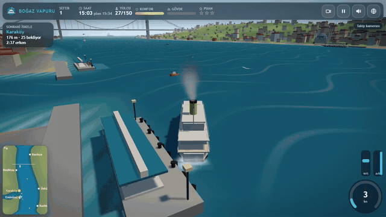

<p align="center">
  <a href="https://furkiozknn.github.io/bogaz-vapuru/"></a>
</p>

<p align="center">
  <a href="https://furkiozknn.github.io/bogaz-vapuru/"></a>
  
  
  <a href="LICENSE"></a>
  
</p>

<p align="center"><b>A 3D ferry-captain game on a low-poly Bosphorus: take the white city ferry with the yellow funnel between six piers, keep the timetable, come alongside gently and carry as many passengers as you can.</b></p>

<p align="center">
  
</p>

<p align="center"><b>Play online: <a href="https://furkiozknn.github.io/bogaz-vapuru/">https://furkiozknn.github.io/bogaz-vapuru/</a></b> (desktop and phone, no install)</p>

## Highlights

- **Six piers, one timetable.** Eminönü, Karaköy, Üsküdar, Beşiktaş, Kadıköy and Kanlıca; each shift is a list of piers
  with departure times, and late arrivals cost points and passengers.
- **Docking is the game.** Come alongside slowly, parallel and close; a docking guide shows distance, speed and angle,
  and when all three are right for half a second the ropes are thrown and the bell rings.
- **A strait that pushes back.** The current flows towards the Marmara and is strongest mid-strait, the wind adds drift,
  and both grow over the campaign.
- **Traffic with its own rules.** Tankers keep to the channel and cannot stop quickly, fishing boats pull aside when you
  sound the horn, and other ferries wait off the piers.
- **Eight shifts and an endless mode.** Dusk, fog, night, a strong current, a storm with rain and thunder, and a convoy
  of five tankers.
- **Balanced by a bot.** The `?auto` captain uses the same controls and rules as a player and finishes the campaign
  with 3 stars on every shift.
- **One file, made in code.** One `index.html` with Three.js r170 from a CDN; the strait, about 1100 buildings, the
  boats, the people, the sounds and the music are all procedural.

## How to play

> [!TIP]
> **Goal:** sail each shift's route on time, dock cleanly at every pier and reach the shift target for 1 to 3 stars.
> No star means the shift must be repeated.

The ferry starts moored at the first pier; once boarding is done and the departure time has come, push the throttle to
cast off. The next pier is marked by a floating beacon and a teal berth box on the water. Come alongside the berth side
of the pier slowly (under about 1 m/s), parallel (within about 20 degrees) and close, and hold it for half a second.

<details>
<summary><b>More rules</b></summary>

- **Hard bumps** (over about 0.7 m/s into a pier, the shore or another boat) damage the hull and upset the passengers.
  At 100 % hull damage the shift is cancelled. Collisions with tankers hurt a lot.
- **Punctuality:** arriving more than 15 s late costs points, and after 40 s the waiting passengers start to give up.
  Arriving early means waiting at the pier until the scheduled departure.
- **Comfort** starts at 100 % and drops with hard docking, collisions, hard rudder at speed, slamming the telegraph from
  ahead to astern and speeding through a storm.
- **Score** = passengers delivered x 10 + punctuality (up to 100 per stop) + comfort x 3 - 5 per lost passenger.
  Stars: 1 at 40 % of the shift target, 2 at 65 %, 3 at 85 %.
- Aim a little up-current when approaching a berth. Tankers blow the horn and slow down a little when something is
  ahead, so stay out of their way.

| # | Shift | What is new |
|---|---|---|
| 1 | First crossing | Eminönü, Karaköy, Üsküdar: learn to dock |
| 2 | Beşiktaş line | longer legs, more traffic |
| 3 | Evening run | five piers while the sun sets, lights come on |
| 4 | Foggy morning | fog: short visibility, trust the minimap |
| 5 | Night shift | night, pier lanterns and bridge lights |
| 6 | Strong current | current 1.0: the ferry drifts mid-strait |
| 7 | Storm | wind, waves, rain, thunder: slow down for comfort |
| 8 | Tanker convoy | a convoy of five tankers at dusk, heavy traffic |
| E | Endless | random routes that get harder; ends on a failed shift |

</details>

### Controls

| Action | Mouse / touch | Keyboard |
|---|---|---|
| Throttle ahead / astern (sticky telegraph) | right lever (up = ahead, down = astern) | `W` / `S` or `Up` / `Down` |
| Rudder (returns to midships) | wheel on the left | `A` / `D` or `Left` / `Right` |
| Horn | horn button | `Space` |
| Camera (chase / bridge / top) | camera button | `C` |
| Orbit the chase camera | drag on the scene, wheel to zoom | |
| Pause | pause button | `P` / `Esc` |
| Music / effects / language | HUD buttons | `M` / `X` / `L` |
| Fullscreen | settings | `F` |

Settings are saved in `localStorage` under `arena.vapur.settings`; best stars and scores and the campaign you can
continue under `arena.vapur.save`. The language follows the browser (Turkish or English); phones start on the Low tier.

<details>
<summary><b>URL flags for testing</b></summary>

| Flag | Effect |
|---|---|
| `?auto` | a captain bot plays the campaign with the same controls and rules (fairway routing, slows for traffic, docks parallel) |
| `?debug` | fps, draw calls, triangles, state, bot results and JS errors on screen; `window.vapurSim(seconds)` fast-forwards |
| `?sim=N` | fast-forward N seconds of the first shift before the first frame (add `&auto` to let the bot sail) |
| `?low` | shadows off, pixel ratio 1, half the particles |
| `?noassets` | skip the lookup for optional sound samples (everything is synthesised anyway) |
| `?lang=en` / `?lang=tr` | language |
| `?shift=N` | start the campaign at shift N |
| `?mode=endless` | with `?auto` or `?sim`, start in endless mode |
| `?seed=N` | gameplay random seed (default 11) |
| `?touch` | force the touch controls |
| `?cal` | with `?auto`: advance to the next shift whatever the result (used to calibrate the targets) |

The live state is on `window.vapur` (state, shift, time, score, target, aboard, delivered, hull, comfort, finished
shifts, errors). Example: `index.html?auto&debug&sim=3000` plays most of the campaign in a few seconds without
rendering.

</details>

## Screenshots

<table>
  <tr>
    <td width="33%"><br><sub>Title screen</sub></td>
    <td width="33%"><br><sub>Moored at Karaköy</sub></td>
    <td width="33%"><br><sub>Dusk run and the docking guide</sub></td>
  </tr>
  <tr>
    <td><br><sub>Night, Maiden's Tower</sub></td>
    <td><br><sub>Storm at Üsküdar</sub></td>
    <td><br><sub>On a phone</sub></td>
  </tr>
</table>

## Balance

Piers, timetables and difficulty are one data table in the code (`PIER_DEF`, `SHIFTS`, `SCORE_K`); a shift's
timetable is derived from the route length and the shift's pace. The `?auto` captain routes through the fairway graph,
compensates the current, slows for traffic and docks by sliding in at a shallow angle. It finishes the campaign with 3
stars on every shift and needed one or two retries on shifts 5, 6 and 8 (night, strong current, convoy), which is the
intended difficulty curve. Measured on an Intel UHD GPU at 1280x720: 21 to 27 draw calls, about 225 000 triangles and
57 fps (vsync-capped) in busy dusk, night, storm and phone scenes on the High tier.

## Running locally

Serve the folder over HTTP (opening `index.html` directly also works in most browsers):

```
python -m http.server 8000
```

then open <http://localhost:8000/>.

## How it was made

Built by **Claude Fable 5.1** with Claude Code from one prompt: [prompts/bogaz-vapuru.md](prompts/bogaz-vapuru.md). The
whole game is procedural: the strait is a signed depth function from which the shoreline, terrain, piers, the bot's
fairway graph and the minimap are derived; the city (about 1100 buildings), the yalı mansions, 1500 trees, the people
and the gulls are instanced; the mosques, the Galata and Maiden's towers, the piers and the suspension bridge are
merged flat-shaded geometry. The water is a patched Lambert material with sine waves and current streaks. The engine,
the two-tone horn, the pier bell, gulls, sea, wind, rain, thunder and a calm saz-and-strings loop are synthesised with
the Web Audio API. No asset files are shipped.

Boğaz Vapuru is part of the **Claude Game Arena** series, where each game is built by a Claude model from one prompt.
The other games: [Kervan](https://furkiozknn.github.io/kervan/) · [Dolmuş](https://furkiozknn.github.io/dolmus/) ·
[Peri Golf](https://furkiozknn.github.io/peri-golf/) · [Mehter](https://furkiozknn.github.io/mehter/) ·
[Simit Fırını](https://furkiozknn.github.io/simit-firini/) · [Karagöz](https://furkiozknn.github.io/karagoz/) ·
[Lale Bahçesi](https://furkiozknn.github.io/lale-bahcesi/)

## Türkçe

**Boğaz Vapuru**, alçak poligon bir İstanbul Boğazı'nda geçen 3D şehir hatları vapuru kaptanlığı oyunu. Eminönü,
Karaköy, Üsküdar, Beşiktaş, Kadıköy ve Kanlıca arasında tarifeye uy; akıntıya ve rüzgâra karşı iskeleye yavaş, paralel
ve yakın yanaş, yolcuları taşı, tankerlerin yolundan çekil. Sekiz sefer ve sonsuz mod var: sis, gece, fırtına ve tanker
konvoyu. Kurulum yok; masaüstünde ve telefonda tarayıcıda oynanır. Claude Fable 5.1 tarafından Claude Code ile tek bir
prompt'tan yapıldı.

**Oyna:** https://furkiozknn.github.io/bogaz-vapuru/

## License

MIT, see [LICENSE](LICENSE).
