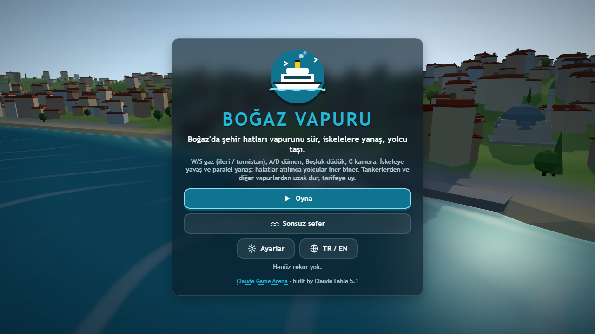
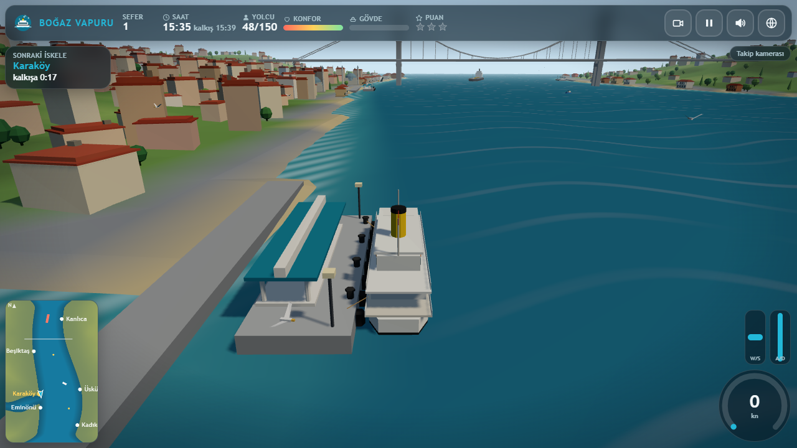
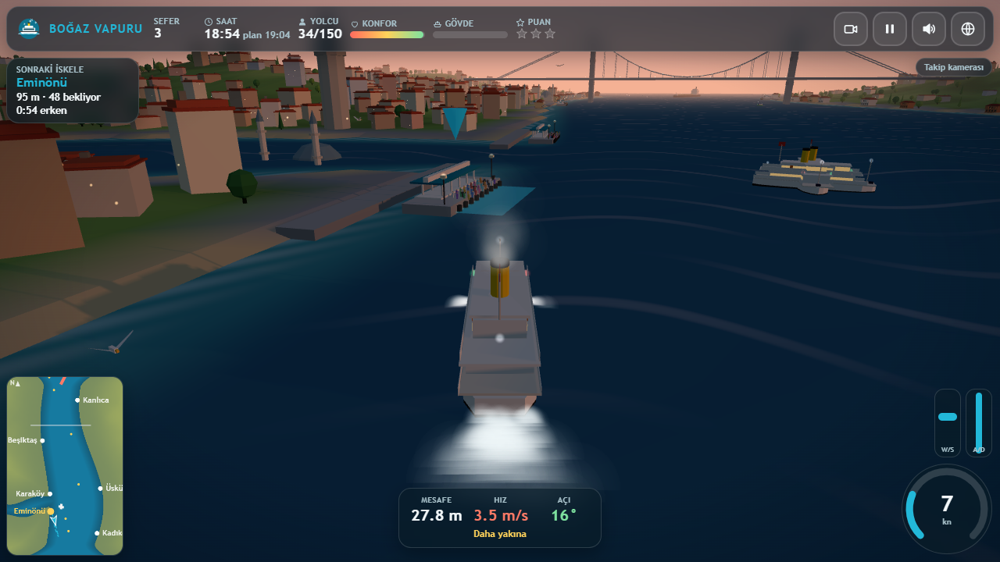
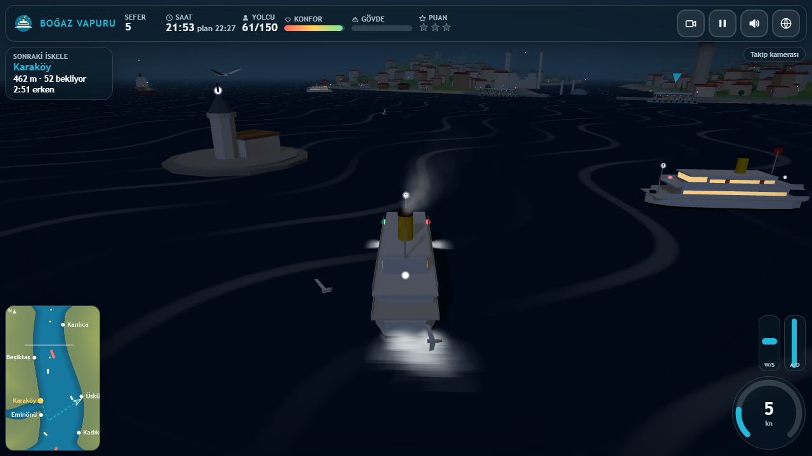
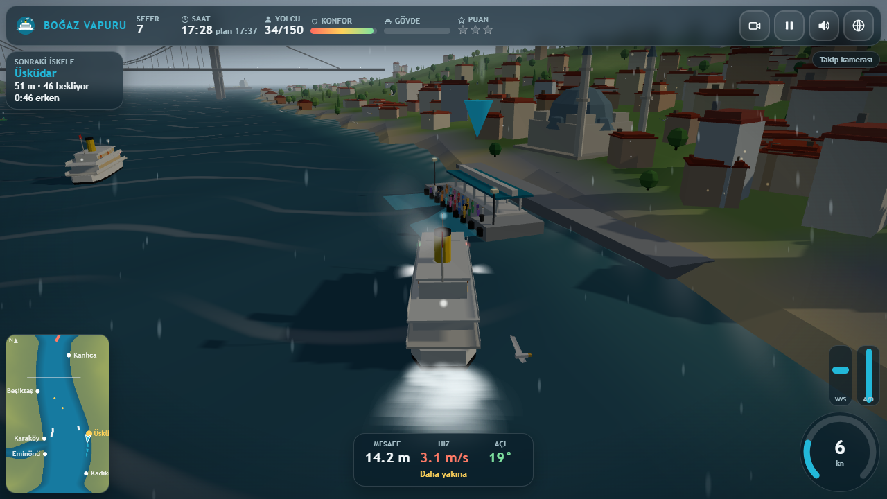
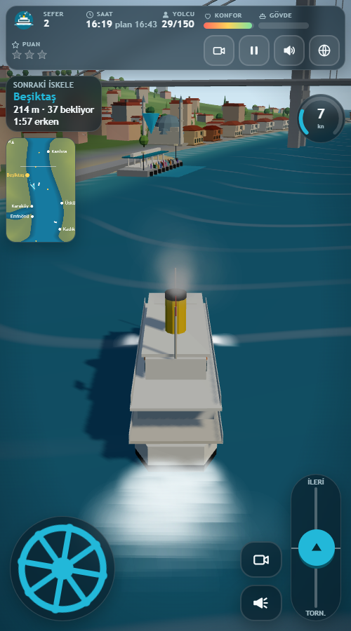

# Boğaz Vapuru
**Play online:** https://furkiozknn.github.io/bogaz-vapuru/ (desktop and phone, no install)

A 3D ferry-captain game set on a stylised, low-poly Bosphorus. Take the classic white-and-black city ferry with the
yellow funnel between six piers (Eminönü, Karaköy, Üsküdar, Beşiktaş, Kadıköy, Kanlıca), keep the timetable, come
alongside gently so the ropes can be thrown, and carry as many passengers as you can while tankers, fishing boats and
other ferries cross the strait. Eight campaign shifts add dusk, fog, night, a strong current, a storm and a tanker
convoy; an endless shift follows.

The game is one `index.html` (HTML, CSS and JavaScript inline). Three.js r170 is loaded from the jsDelivr CDN as an
ES module, so the first load needs an internet connection. Everything in the scene (the strait, the city, the boats,
the people, the sounds and the music) is procedural; a few optional CC0 one-shot samples can live in `assets/sfx/`
and are skipped silently when missing.

Part of the **Claude Game Arena** (round 4, game 1). Built by Claude Fable 5.1 with Claude Code from one prompt:
[`prompts/bogaz-vapuru.md`](prompts/bogaz-vapuru.md).



## Play

Serve the folder over http (opening the file directly also works in most browsers):

```bash
python -m http.server 8000
# open http://localhost:8000/
```

The game starts in Turkish. Press `L` (or the globe button) for English.

### How to play

* Each shift is a list of piers with a timetable (shown on the shift card). The ferry starts moored at the first pier;
  once boarding is done and the departure time has come, push the throttle to cast off.
* **Docking:** the next pier is marked by a floating beacon and a teal berth box on the water. Come alongside the berth
  side of the pier *slowly* (under about 1 m/s), *parallel* (within 20 degrees) and *close* (under 3 m). The docking
  guide at the bottom shows distance, speed and angle and turns green when each is right. Hold it for half a second and
  the ropes are thrown, the bell rings, passengers walk off and new ones walk on.
* **Hard bumps** (over about 0.7 m/s into a pier, the shore or another boat) damage the hull and upset the passengers.
  At 100 % hull damage the shift is cancelled. Collisions with tankers hurt a lot.
* **Punctuality:** arriving more than 15 s after the scheduled time costs points, and after 40 s the waiting passengers
  start to give up (each one lost costs points). Arriving early means waiting at the pier until the scheduled departure.
* **Comfort** starts at 100 % and drops with hard docking, collisions, hard rudder at speed, slamming the telegraph from
  ahead to astern and speeding through a storm.
* **Score** = passengers delivered x 10 + punctuality (up to 100 per stop) + comfort x 3 - 5 per lost passenger.
  Stars: 1 at 40 % of the shift target, 2 at 65 %, 3 at 85 %. No star means the shift must be repeated.
* The current flows towards the Marmara and is strongest in the middle of the strait; the wind adds drift. Both grow
  over the campaign, so aim a little up-current when approaching a berth.
* The **tankers** keep to the channel and cannot stop quickly: they blow the horn and slow down a little when something
  is ahead, so stay out of their way. Fishing boats pull aside when you sound your horn. Other ferries wait off the piers.

### Controls

| Action | Keyboard | Touch |
|---|---|---|
| Throttle ahead / astern (sticky telegraph) | `W` / `S` or `Up` / `Down` | right lever (up = ahead, down = astern) |
| Rudder (returns to midships) | `A` / `D` or `Left` / `Right` | wheel on the left |
| Horn | `Space` | horn button |
| Camera (chase / bridge / top) | `C` | camera button |
| Orbit the chase camera | mouse drag, wheel to zoom | drag on the scene |
| Pause | `P` / `Esc` | pause button |
| Music / effects / language | `M` / `X` / `L` | HUD buttons |
| Fullscreen | `F` or `F11` | Settings |

### Shifts

| # | Name | What is new |
|---|---|---|
| 1 | First crossing | Eminönü, Karaköy, Üsküdar: learn to dock |
| 2 | Beşiktaş line | longer legs, more traffic |
| 3 | Evening run | five piers while the sun sets, lights come on |
| 4 | Foggy morning | fog: short visibility, trust the minimap |
| 5 | Night shift | night, pier lanterns and bridge lights |
| 6 | Strong current | current 1.0: the ferry drifts mid-strait |
| 7 | Storm | wind, waves, rain, thunder: slow down for comfort |
| 8 | Tanker convoy | a convoy of five tankers at dusk, heavy traffic |
| E | Endless | random routes that get harder; ends on a failed shift |

Timetables, piers and difficulty are one data table in the code (`PIER_DEF`, `SHIFTS`, `SCORE_K`). The timetable of a
shift is derived from the route length and the shift's pace, so a careful captain who docks cleanly and keeps the
schedule gets 3 stars, and a reckless one who bumps the piers and loses passengers fails.

Best stars and scores and the campaign you can continue are stored in `localStorage` (`arena.vapur.save`); settings in
`arena.vapur.settings`.

## Flags (URL query)

| Flag | Effect |
|---|---|
| `?auto` | a real captain bot plays the campaign with the same controls and rules (routes through the fairway, slows for traffic, docks parallel) |
| `?debug` | shows fps, draw calls, triangles, state, bot results and any JS errors on screen; exposes `window.vapurSim(seconds)` |
| `?sim=N` | fast-forwards N seconds of the first shift before the first frame (add `&auto` to let the bot sail) |
| `?low` | low quality: shadows off, pixel ratio 1, half the particles |
| `?noassets` | skip the optional sound samples (everything is synthesised anyway) |
| `?lang=en` / `?lang=tr` | language |
| `?shift=N` | start the campaign at shift N |
| `?mode=endless` | with `?auto` or `?sim`, start in endless mode |
| `?seed=N` | change the gameplay random seed (default 11) |
| `?touch` | force the touch controls |
| `?cal` | with `?auto`: advance to the next shift whatever the result (used to calibrate the targets) |

The live state is available as `window.vapur` (state, shift, time, score, target, aboard, delivered, hull, comfort, the
log of finished shifts, errors, loaded assets). Example: `index.html?auto&debug&sim=3000` plays most of the campaign in a
few seconds without rendering and leaves the result on screen.

## Screenshots

| | |
|---|---|
|  |  |
|  |  |
|  | |

## Technical notes

* **World:** the strait is a signed "depth" function (a winding channel plus the Golden Horn inlet); the shoreline,
  the terrain, the pier positions, the fairway graph for the bot and the minimap all derive from it. Land is one
  vertex-coloured mesh; the city (about 1100 buildings), the yalı mansions, 1500 trees, the people and the gulls are
  `InstancedMesh`es; the mosques, Galata and Maiden's towers, the piers and the suspension bridge are merged
  flat-shaded geometry. Night lights are one `Points` cloud with a soft sprite.
* **Water:** a `MeshLambertMaterial` with an `onBeforeCompile` patch: three sine waves displace the vertices and bend
  the normals, the shallow water near the shore is tinted, the current shows as moving streaks that are stronger in
  the middle of the strait, and a small sun glint is added. The sky is a gradient dome with the sun, the moon and stars.
* **Ferry physics:** surge / sway / yaw with inertia, quadratic drag, a telegraph that responds with lag, rudder
  authority that grows with water flow (speed or prop wash), heel in turns, drift from the current field and gusty
  wind. Collisions use three hull circles against oriented pier rectangles, the depth field (running aground) and the
  circles of the other boats; the normal impact speed decides the damage and the comfort loss.
* **Traffic rules:** every boat looks ahead in a cone; ferries and fishing boats stop for anything ahead, tankers only
  slow down and sound the horn. Fishing boats give way to your horn.
* **Rendering:** one directional light with a 1024 px shadow map that follows the ferry (it turns into moonlight after
  sunset), a hemisphere light, Lambert materials everywhere, pixel ratio capped at 1.5, no post-processing.
* **Measured** on an Intel UHD Graphics (ANGLE / Direct3D 11) at 1280x720 in headless Chrome: 21 to 27 draw calls,
  about 225 000 triangles, 57 fps (vsync-capped) in busy dusk, night, storm and phone scenes, High quality.
* **Bot calibration:** the `?auto` captain finishes the campaign with 3 stars on every shift; it needed one or two
  retries on shifts 5, 6 and 8 (night, strong current, convoy), which is the intended difficulty curve.
* **Audio:** Web Audio only. Engine thrum (saw + sub sine through a lowpass, amplitude-modulated), a deep two-tone horn,
  the pier bell, gulls, sea, wind, rain, thunder and a calm saz-and-strings loop in a Hüseyni-like scale (plucked saz
  with vibrato, sustained string chords, a soft frame drum).
* **Self-test:** the bot routes through the fairway graph, compensates the current when steering, slows for traffic and
  shallow water, and docks by sliding in at a shallow angle before aligning with the berth.

## Files

```
index.html     the whole game (HTML, CSS, JavaScript)
prompts/       the prompt this game was built from
docs/          screenshots
LICENSE        MIT
```

## Known issues

* Needs WebGL 2 and a network connection for the Three.js CDN on the first load.
* No external assets are shipped: `assets/sfx/*.mp3` are optional CC0 one-shots the game looks for after the first
  frame and quietly does without (`?noassets` skips the lookup). Every sound is synthesised.
* The bot captain is cautious: it can take a second attempt at a berth in a strong current and sometimes runs aground
  while backing out of a corner (Golden Horn mouth); it recovers on its own but loses time.
* Pressing `P` in the headless test harness did not pause (keyboard focus); the pause button and `Esc` work in a real
  browser session, which was not tested by hand.
* The AI ferries wait off the piers rather than at a berth of their own, so they never block your berth (by design).
* The chase camera does not avoid the bridge deck or the towers; it can clip through them for a moment when you pass
  under the bridge with the camera orbited.

## License

MIT, see [`LICENSE`](LICENSE). Copyright (c) 2026 Furkiozknn.
